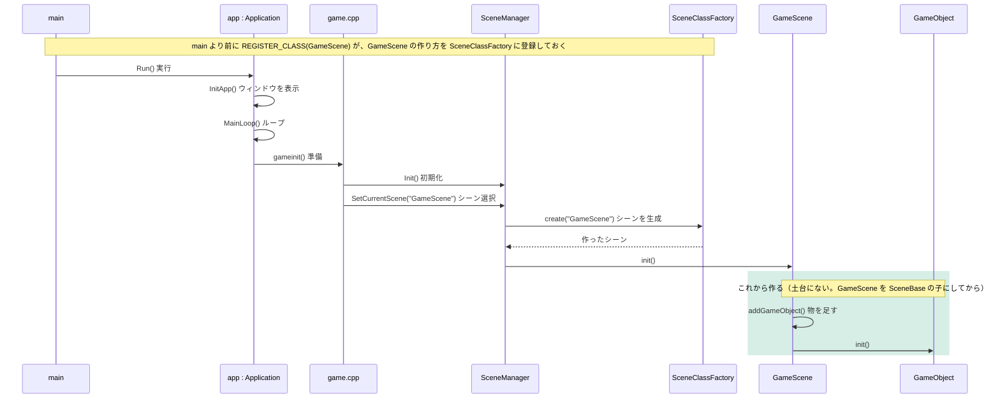
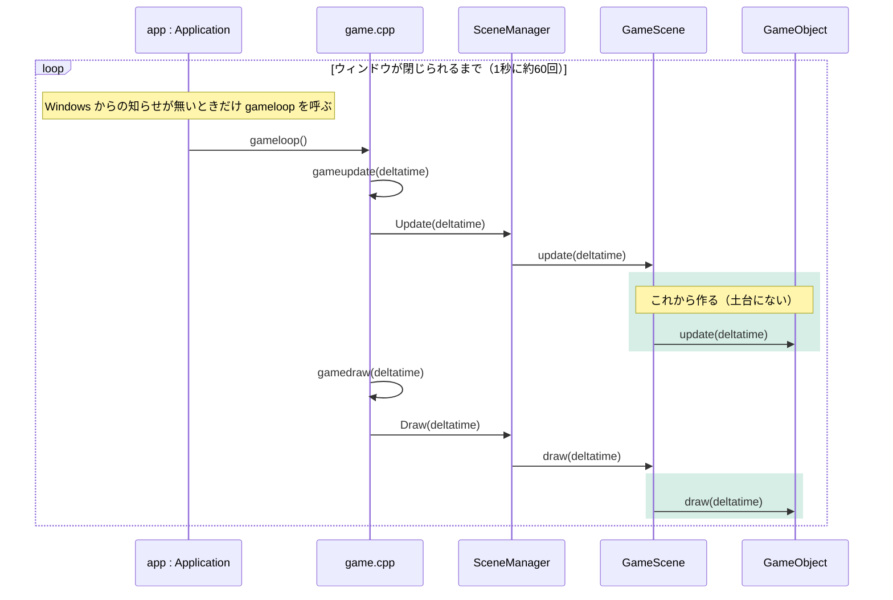
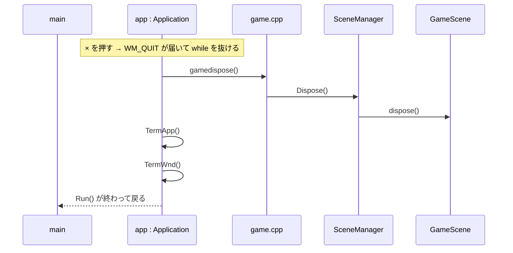

# ステルスゲーム 開発ログ

3D ステルスゲーム（就職作品・2作目）の開発記録。11/26 に新しいリポジトリで作り直した。

**このログの目的**は日記ではなく、**ポートフォリオの材料を溜めること**。
半年後に「なぜこう作ったのか」を思い出せる形で残す。特に **「判断と理由」** は、
後から絶対に思い出せないので、その日のうちに書く。

**書き方**：1サイクルごとに書く（「質問 → 解説 → 実行 → 振り返り」。`作り直しの計画.md`）。3行でもいい。

- 計画：`企画シート.md`・`作り直しの計画.md`（同じフォルダ）
- 11/21〜11/25 の記録：古いリポジトリ `StealthGame-old` の `docs/devlog.md`（企画を決めた日の判断と理由もそこにある）
- 環境: Windows 11 / Visual Studio / DirectX 11 / C++ / 鈴木先生の授業の土台（GP23 PBR・BC7 版）

---

## 2026-11-26（木）新しいリポジトリで、最低限の土台から作り直した（サイクル1）

### やったこと
- 古いリポジトリを `StealthGame-old` にしまった（GitHub とパソコンのフォルダの名前を変えた）
- 鈴木先生の土台（10/17 の GP23 PBR・BC7 版）から、最低限だけを持ってきて `StealthGame` を作った
  - 持ってきた：`system/`・`utility/`・`shader/`・入口（main・Application・game・fpscontrol）・`gameobject.h`
  - 外した：`assets/`（969MB）・デモの物（enemy・field・player・wall・`.bak`）・デモのシーン・ビルドでできるもの。約 1,000MB → 約 4MB
  - 空の `GameScene` を `src/game/scenes/` に置いて、`game.cpp` で最初に開くシーンにした
- ビルドして、何もない画面が出るのを確かめた
- GitHub に公開のリポジトリ `StealthGame` を作って push した
- 古い devlog は持ってこずに、この devlog を新しく始めた
- Obsidian のノートを分けた：古いものは `ステルスゲーム-old`（ノートの頭は `STold`）として残し、`ステルスゲーム` は新しいリポジトリから作り直した。先生の土台のノートの `//▷` は、コードが同じなので新しいほうにも引き継いだ

| コミット | 内容 |
|---|---|
| `512c44d` | 鈴木先生の土台（GP23 PBR・BC7 版）から最低限だけで StealthGame を作った |

### 詰まったこと・解決
- このパソコンに GitHub CLI（`gh`）が入っていなかった → ブラウザで GitHub のリポジトリを作って、git で push した

### 判断と理由
<!-- 後から絶対に思い出せない。ここだけは必ず書く -->
- **計画を変えて、全部ではなく最低限だけ持ってきた**：計画では「デモをそのまま全部コピーして、図を描いてから削る」だった。でも、今後使わないものがいっぱい入っていて、ファイルが重たくなる。使うときに、元の場所からコピーして持ってくればよい
- **土台の部品（`system/`）は全部残した**：計画で「土台は書き直さない」と決めている。`system/` は 4MB しかないので、残しても重さはほとんど変わらない（1,000MB のうちの 99% は `assets/`）。どの部品が要るかは、C で図を描いてからでないと決められない。部品どうしは `#include` でつながっているので、今削るとビルドが壊れるおそれもある
- **コードを `src/` にまとめた**：先生の土台と自分のコードを分けるため。自分のコードは `src/game/`、それ以外は先生の土台。面接官がリポジトリを開いたときに、どこからが自分のコードかが一目でわかる
- **Obsidian の古いノートは消さずに、別の名前（ステルスゲーム-old・STold）で残した**：もし詰まったときに見返せるように。古いコードに付けた `//▷` の解説は、消すと元に戻せない。名前の頭を変えたのは、新しいノートと `[[リンク]]` がぶつからないようにするため
- **devlog を新しく始めた**：プロジェクトも一から始めたから。リポジトリと devlog を1対1にした。前の判断と理由・要復習は古いほうに分かれるので、いちばん上に古い devlog の場所を書いた

### 理解できていなかったこと（要復習）
- **シーンを名前で呼ぶ仕組み**：`game.cpp` が `SetCurrentScene("GameScene")` と文字列で呼ぶ → `SceneClassFactory` が、登録された名前の表からシーンを作る。名前は `REGISTER_CLASS(GameScene)` で登録する。このマクロは、プログラムが始まるとき（main より前）に動く変数を作って、その中で登録している
- **`.vcxproj.filters`**：VS のソリューションエクスプローラーに並べる「仮のフォルダ」の設定。本物のフォルダとは関係ない。今回は持ってこなかったので、「すべてのファイルを表示」で本物のフォルダの形で見る
- **git の「LF will be replaced by CRLF」**：先生のファイルの一部は改行が LF（Mac・Linux 式）。git が取り出すときに Windows 式の CRLF にする設定なので、その知らせ。中身は変わらない

### 振り返り（作り直しの型）
- 図と実際のコードの違い：このサイクルは図を描いていない（コピーと設定だけ）
- 4つの視点：① できないことをできるようにする（まず動かす）。何もない画面が出るところまで

### 次
- サイクル2（C1）：`main` → `Application` → シーン → `GameObject` の流れを、自分でシーケンス図に描く
- 後に回したこと
  - `GameScene` の関数名（`update` など）が小文字のまま。土台の `IScene` の名前をそろえるときに直す（`TODO:` を書いた）

---

## 2026-11-26（木）② 土台の流れをシーケンス図にした（サイクル2・C1）

### やったこと
- 土台の「起動」の流れを、手書きのシーケンス図に描いた（4回描き直した）。下の「起動」の図は、手書きの図を AI に Mermaid へ書き写してもらったもの。矢印の文字には関数名を足した
- 「毎フレーム」と「終了」の流れは、AI に Mermaid で描いてもらった
- 作り直しの計画の C1 を変えた（自分で描くのは起動だけにした）
- コードは変えていない

### 図：起動（自分で描いた）



### 図：毎フレーム（AI に描いてもらった）



### 図：終了（AI に描いてもらった）



- 3枚とも、Renderer・入力（CInputManager）・DebugUI・Windows の関数（CreateWindowEx など）は省いた

### 詰まったこと・解決
- 最初の図で `main` → `SceneManager` に矢印を引いた → `main.cpp` を開くと、`Application` を作って `Run()` を呼ぶだけだった。予想で描かずに、**ファイルに書いてある行だけを矢印にする**
- 箱に `Application::Run` と書いた → 箱は「人」（`app : Application`）、関数は矢印に書く
- 「ループ」と「ウィンドウ」の順番を逆に描いた → `Run()` の中は `InitApp()`（ウィンドウ）→ `MainLoop()`（ループ）→ `TermApp()`（片付け）の順。ウィンドウが無いと、ゲームを映す場所が無い
- `gameinit()` がどこで呼ばれているかわからなかった → `Application.cpp` の `MainLoop()` の中、`while` の前（196行目）。関数名の上で **F12（定義へ移動）** を押すと中身に飛べるので、「F12 → 上から読む → 次の関数名で F12」をくり返すと矢印が順に見つかる

### 判断と理由
<!-- 後から絶対に思い出せない。ここだけは必ず書く -->
- **`GameObject` も図に入れた**：継承のときに使うと思ったから。`gameobject` には中身のない関数（`= 0`）が4つあって、Player や Enemy は必ずこれを継承する。ただし、`GameObject` の `update`・`draw` を呼ぶコードは土台にも先生のデモにも無かったので、緑の箱「これから作る」で囲んだ。次に自分で設計するところになる
- **土台の図は「起動」だけ描いて、「毎フレーム」「終了」は AI に描いてもらった**：土台の図はポートフォリオに載せない。授業のポートフォリオ例（GM31 04 の p13・p14）も、載っているシーケンス図は「当たり判定」「敵AI」のようなゲームの中身。この図の目的は「自分のコードが土台のどこにつながるか」を知ることなので、`GameScene` が呼ばれるところまでわかれば足りる。毎フレームの形は、起動の図の `gameloop → gameupdate → gamedraw` とほとんど同じ
- **Renderer・入力・DebugUI・Windows の関数は描かなかった**：シーンの流れとは別の脇役。全部描くと矢印が何十本にもなって、シーンまでたどり着かない
- **図は devlog に Mermaid で残した**：Obsidian に写るのは devlog だけ（`stealth_only.sh`）。Obsidian は Mermaid をそのまま図にできる

### 理解できていなかったこと（要復習）
- **1行を矢印にする読み方**：`.`・`->`・`::` の左が「誰に」、右が「何を（関数名）」。`obj->init()` なら「`obj` に `init()` を頼む」
- **戻りの点線**：`auto obj = …create(…)` の `obj =` は、作ってもらったものを受け取っているしるし。図では呼ばれた側から点線で戻す。値を返さない関数（`void`）は戻りを描かなくてよい
- **自分の関数を呼ぶときは、自分に戻る矢印**：`app` の `Run()` の中で `InitApp()` を呼ぶ、など
- **`getInstance()`**：`SceneClassFactory` の係を取り出すための決まった書き方（1つしか作らない物を取り出す。シングルトンという）。図には描かない
- **`gameloop()` は毎回呼ばれるわけではない**：`MainLoop()` は、Windows からの知らせ（マウス・ウィンドウの移動など）が来ていたら先にそちらを片付けて、来ていないときだけ `gameloop()` を呼ぶ
- **片付けは起動と逆向き**：シーンを片付けてから、ウィンドウを片付ける

### 振り返り（作り直しの型）
- 図と実際のコードの違い：最初の図は `main` → `SceneManager`（予想）だった。実際は `main` → `app` → `game.cpp` → `SceneManager` → `GameScene`。計画に書いていた `GameObject` も、実際には一度も呼ばれていなかった
- 4つの視点：① できないことをできるようにする。まだ作っていない。何が動いているかを知る段階

### 次
- C2（クラス図）をやるかどうかを、次のチャットの最初に決める（土台の図はポートフォリオに載せないので、同じ理由で減らせるかもしれない）
- `GameObject` を毎フレーム動かす仕組みを、図を先に描いてから作る（`GameScene` を `SceneBase` の子にする・「次に入れる箱」から本物の箱へ移す・`update`・`draw` を呼ぶ・`Destroy()` された物を消す）

---

# テンプレート（コピーして使う）

```markdown
## 2026-MM-DD（曜）タイトル

### やったこと
-

| コミット | 内容 |
|---|---|
| `xxxxxxx` |  |

### 詰まったこと・解決
-

### 判断と理由
<!-- 後から絶対に思い出せない。ここだけは必ず書く -->
<!-- 「なぜ他の方法ではなくこれを選んだか」 -->
-

### 理解できていなかったこと（要復習）
-

### 振り返り（作り直しの型）
- 図と実際のコードの違い：
- 4つの視点：

### 次
-
```
